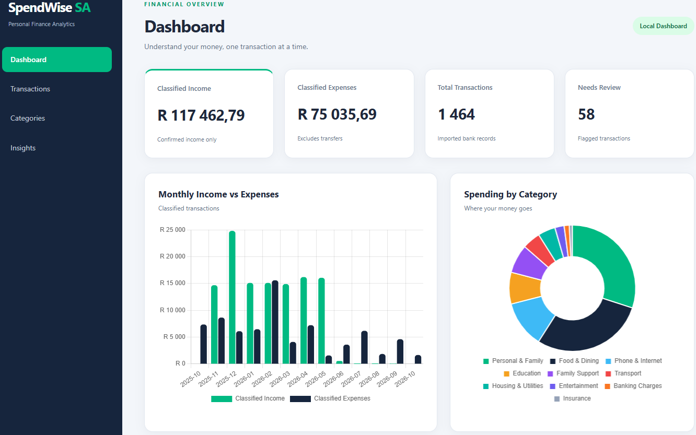
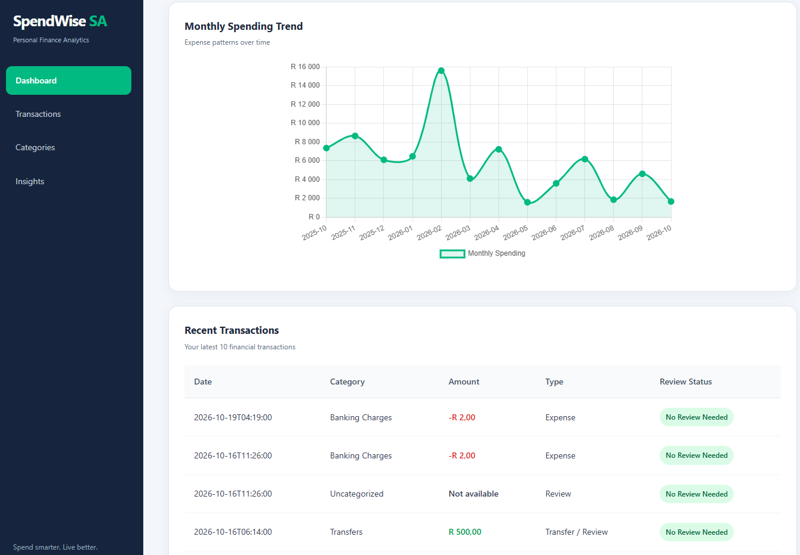
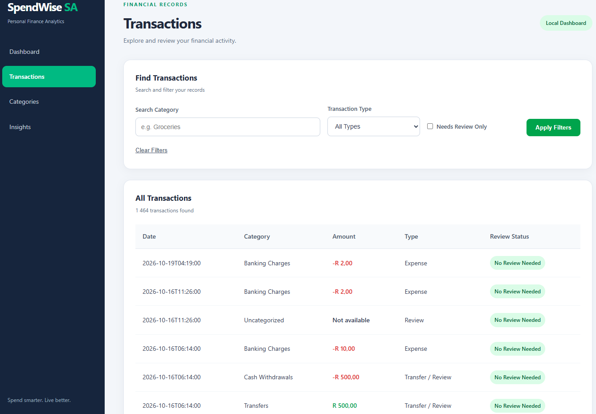
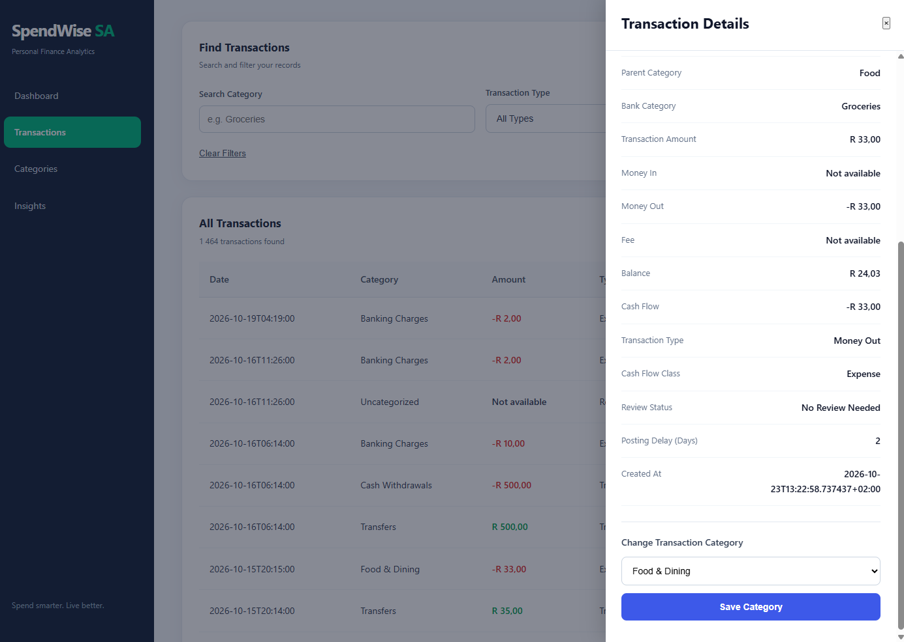
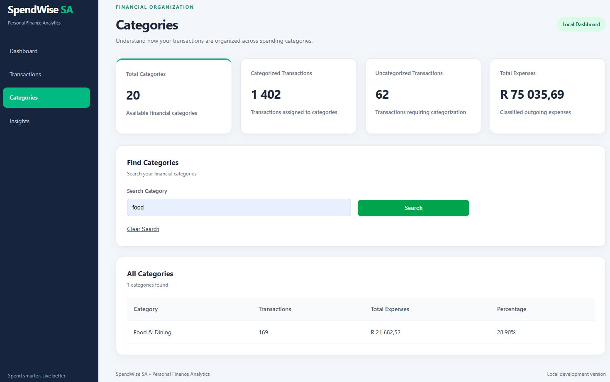
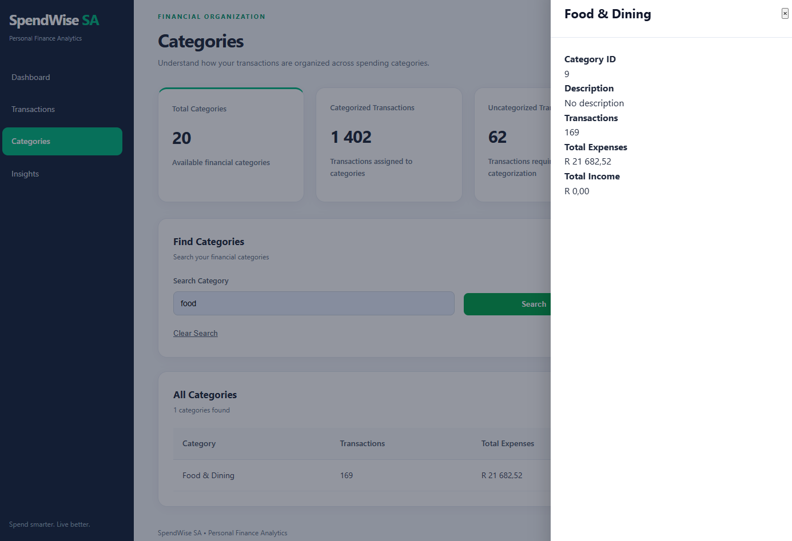
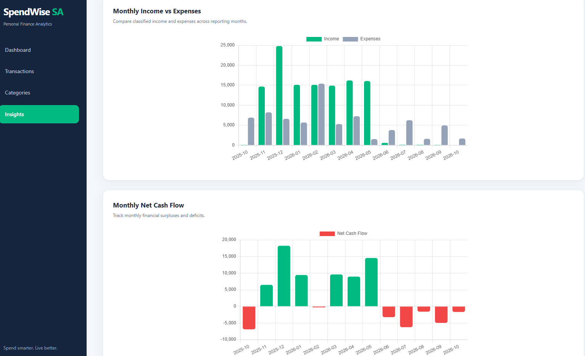

# SpendWise SA 🇿🇦

### Personal Finance Analytics Platform

**SpendWise SA** is a full-stack personal finance analytics application built using Python, FastAPI, PostgreSQL, SQL, JavaScript, HTML, CSS, and Chart.js.

The project demonstrates how financial transaction data can be extracted, transformed, categorized, stored, and presented through interactive dashboards.

The goal is to transform raw banking transaction data into meaningful financial insights while demonstrating practical backend development, database management, data engineering, and frontend integration skills.

---

## Technology Stack

| Component | Technology |
|---|---|
| Backend | Python, FastAPI |
| Database | PostgreSQL |
| Database Connectivity | Psycopg |
| Data Processing | Python, SQL |
| Frontend | HTML, CSS, JavaScript |
| Data Visualization | Chart.js |
| Version Control | Git and GitHub |

## Key Features

### 1. Financial Dashboard

- Financial summary cards
- Income and expense overview
- Transaction statistics
- Monthly spending trends
- Spending distribution by category
- Recent transactions

### 2. Transaction Management

- View imported financial transactions
- Filter and search transactions
- Review transaction classifications
- Explore income and expense records

### 3. Categories Management

- View transaction categories
- Analyze category usage
- Monitor classified and unclassified transactions
- Review category-related financial summaries

### 4. Financial Insights

- Monthly income and expense analysis
- Monthly net classified cash flow
- Interactive financial charts
- Historical financial summaries
- Financial performance comparison across reporting months

---

## Application Screenshots

### Dashboard





### Transactions





### Categories





### Financial Insights



---

## System Architecture

SpendWise SA follows a database-backed application architecture:

**Financial Data → Python Extraction and Transformation → PostgreSQL → FastAPI REST API → JavaScript Frontend → Interactive Dashboards**

The Python processing layer handles transaction extraction, cleaning, categorization, and validation.

PostgreSQL stores structured transaction and category information.

FastAPI exposes financial summaries and transaction data through REST endpoints.

The frontend consumes API responses and displays financial information through tables, summary cards, and interactive Chart.js visualizations.

---

## Project Structure

```text
spendwise-sa/
├── docs/
│   └── screenshots/
├── frontend/
│   ├── css/
│   ├── js/
│   ├── index.html
│   ├── transactions.html
│   ├── categories.html
│   └── insights.html
├── scripts/
├── sql/
│   └── schema.sql
├── src/
│   ├── api/
│   ├── database/
│   ├── extract/
│   └── transform/
├── .gitignore
├── README.md
└── requirements.txt
```

---

## Getting Started

### Prerequisites

- Python
- PostgreSQL
- Git
- A modern web browser
- VS Code or another development environment

### Installation

Clone the repository:

```bash
git clone https://github.com/ShadrackHero/spendwise-sa.git
cd spendwise-sa
```

Create a virtual environment:

```bash
python -m venv .venv
```

Activate it on Windows PowerShell:

```powershell
.\.venv\Scripts\Activate.ps1
```

Install dependencies:

```bash
pip install -r requirements.txt
```

### Database Configuration

Create a `.env` file in the project root and configure the PostgreSQL connection:

```env
DB_HOST=localhost
DB_PORT=5432
DB_NAME=your_database
DB_USER=your_username
DB_PASSWORD=your_password
```

The `.env` file is excluded from version control.

The repository includes `sql/schema.sql` for database schema reference. Database setup and data-loading steps may require additional configuration.

### Initialize the Database

Create an empty PostgreSQL database named `spendwise_db`.

Then import the database schema using:

```powershell
psql -U postgres -d spendwise_db -f sql/schema.sql
```

Replace `postgres` with your configured PostgreSQL username if necessary.

The schema creates the application's database tables and relationships.

**Note:** The repository does not include private banking records or populated transaction data. The database must be populated separately before the dashboard can display financial analytics.

### Start the Backend

```bash
uvicorn src.api.main:app --reload
```

### Start the Frontend

Open `frontend/index.html` using a local development server such as VS Code Live Server.

The application requires a running backend and configured PostgreSQL database.

---

## Data Disclaimer

SpendWise SA is an educational and portfolio project.

The demonstration uses fictional financial transaction data designed to reflect realistic South African banking scenarios. The data structure is informed by real-world bank statement formats.

The application is not affiliated with any financial institution.

---

## Current Development Status

Completed functionality includes:

- Transaction extraction and transformation
- PostgreSQL transaction storage
- Financial transaction categorization
- FastAPI backend integration
- Financial dashboard
- Transaction management interface
- Categories management interface
- Monthly financial insights and charts

### Planned Improvements

- Improved transaction classification accuracy
- Automated categorization rules
- Enhanced financial reporting
- Expanded data validation
- Additional financial analytics

---

## Author

Developed as a practical full-stack software development and financial data analytics portfolio project.

**SpendWise SA — Turning financial data into meaningful insights.**